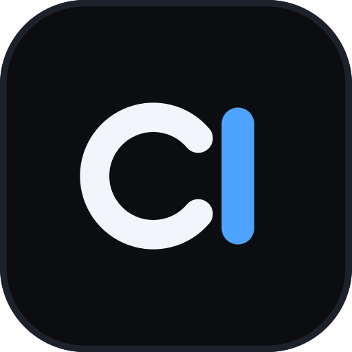

# cl-gfx

<p align="center"></p>

`cl-gfx` is a graphics/performance configurator for PUBG Mobile and its regional builds.
It is an independent app (`com.clgfx`) with no ads, no analytics, no billing, no premium
gating, no remote calls and no network permission.

> **Disclaimer:** cl-gfx is not affiliated with or endorsed by KRAFTON, Tencent or any
> PUBG publisher. Game names are trademarks of their owners. Editing game config files
> may violate the game's terms of service. Use at your own risk.

## What it does

1. Builds a complete `UserCustom.ini` for the selected game using PUBG's own
   `[UserCustom DeviceProfile]` / `+CVars=<hex-xor>` format.
2. Optionally installs a matching render/control profile (`Active.sav`) after backing
   up the existing one.
3. Writes the matching sound/water block (shipped as `faq1..6.ini` assets) into
   `UserSettings.ini`.
4. Can launch the selected game.

## Requirements

- Android 7.0 (API 24) or newer.
- **Android 13+**: the official [Shizuku](https://shizuku.rikka.app/) app, started via
  Wireless debugging (or root), with cl-gfx authorized.
- **Android 10–12**: storage access to the game's `Android/data/<package>` directory.
  See [architecture.md](docs/architecture.md#storage-routing).
- Root is **not** required.

## Install

Grab the APK from the Releases tab, or build it yourself ([docs/build.md](docs/build.md)):

```sh
./build.sh
adb install -r build/cl-gfx.apk
```

Source builds are debug-signed. Re-sign `build/cl-gfx.apk` with your own key if you prefer.

## First run

### Android 13–16+

1. Install the official Shizuku app.
2. Developer options → enable **Wireless debugging**.
3. Open Shizuku → **Start via Wireless debugging**.
4. Reopen cl-gfx and tap **Apply**; allow cl-gfx when Shizuku asks.
5. If the permission was denied, open Shizuku → **Authorized apps** → allow cl-gfx.
6. Pick the game, choose options, then **Apply**. **Launch game** starts it.

If Shizuku is missing or not running, cl-gfx shows a setup dialog with these steps. The
**Shizuku setup / permission** button rechecks the connection at any time.

### Android 10–12

1. Grant the storage permission prompt.
2. Pick the game.
3. If Apply reports that it could not write, tap **Choose config folder** and select
   the game's `Android/data/<package>` folder (or its `Android/data`, or its
   `ShadowTrackerExtra` folder — all three are detected).
4. **Apply** writes the config. **Launch game** starts it.
5. If you install a render profile, the previous `Active.sav` is kept as
   `Active.sav.clgfx.bak`; **Restore Active.sav** puts it back.

Close the game completely before applying and before launching.

## Supported games

| Label        | Package                     |
|--------------|-----------------------------|
| Global       | `com.tencent.ig`            |
| BGMI (India) | `com.tencent.tmgp.pubgmhd`  |
| China        | `com.rekoo.pubgm`           |
| Korea        | `com.pubg.krmobile`         |
| Vietnam      | `com.vng.pubgmobile`        |
| Taiwan       | `com.pubg.imobile`          |
| Lite         | `com.tencent.iglite`        |
| Global Beta  | `com.tencent.igce`          |

## Documentation

- [config-format.md](docs/config-format.md) — the PUBG config format and the
  option→CVar mappings.
- [architecture.md](docs/architecture.md) — app structure, storage routing, safety rules.
- [shizuku.md](docs/shizuku.md) — Android 13+ setup, UserService design, escaping rules.
- [build.md](docs/build.md) — building the APK with `build.sh`.
- [changelog.md](docs/changelog.md) — what changed and when.

## Contributing

Issues and pull requests are welcome. Rules: no network access, no analytics, no
ads, and no new runtime dependencies (the build is plain `aapt2` + `javac` + `d8`, no
Gradle). Option → CVar mappings live in `java/com/clgfx/Ini.java`; if you change one,
say how you verified it on a device.

## License

[MIT](LICENSE). Vendored libraries in `libs/` keep their own licenses; see
[libs/README.md](libs/README.md).
